# ЭЛТ-ЭЛЕКТРО  
веб-приложение интернет-магазина электроники (главная страница),
проект выполнен в рамках лабораторной работы  

## стек технологий:
* **Backend:** Python 3.11, FastAPI, SQLAlchemy 2.0 (ORM), Alembic (миграции)
* **База данных:** PostgreSQL 16
* **Frontend:** HTML5, CSS3, Vanilla JavaScript (Fetch API)
* **Инфраструктура:** Docker, Docker Compose
* **Архитектура:** REST API (клиент-сервер)


## Описание главной страницы
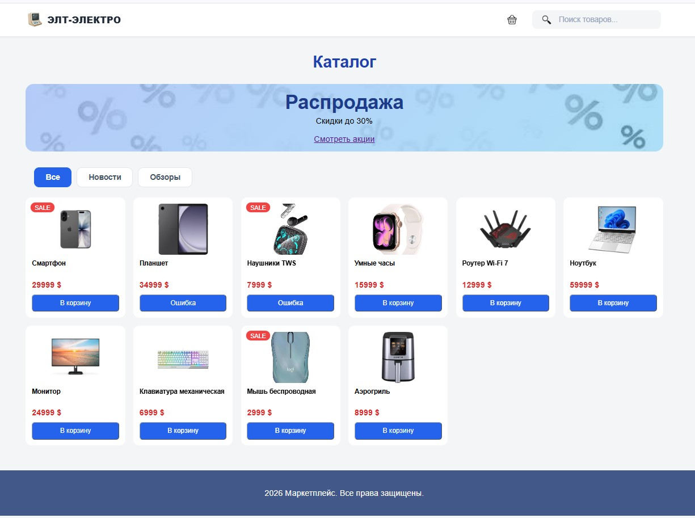  

Шапка сайта  
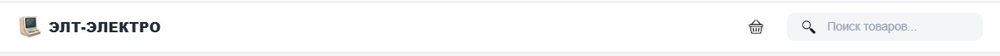  
Содержит логотип, иконку корзины и строку поиска. Поиск работает в реальном времени: при вводе текста и нажатии Enter список товаров фильтруется.  

Баннер
  
Рекламный блок с информацией о распродаже.  

Фильтры 
  
Кнопки «Все», «Новости» и «Обзоры». При нажатии на них отправляется запрос к API, и на странице остаются только товары из выбранной категории.  
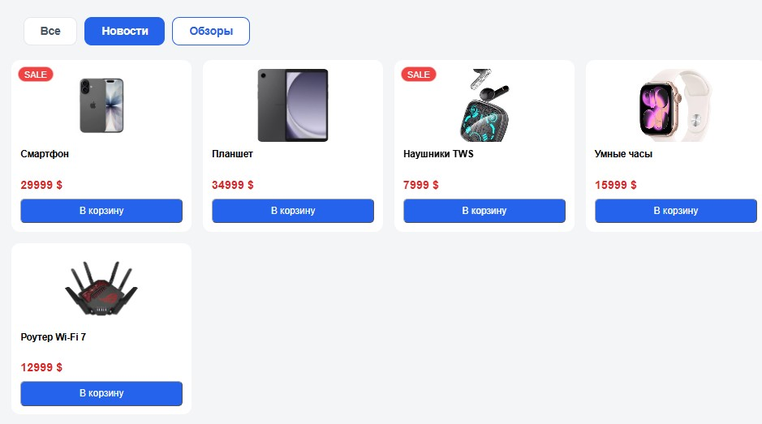 
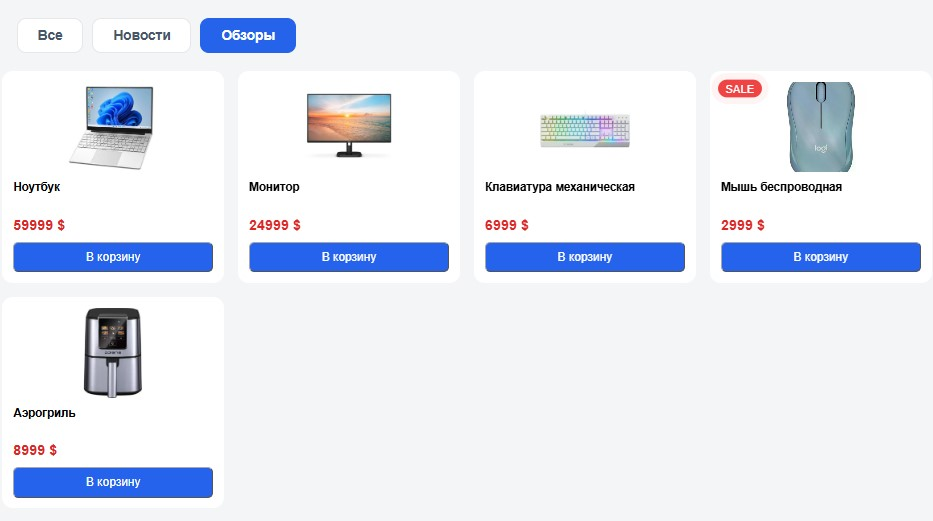 

 
Сетка товаров  
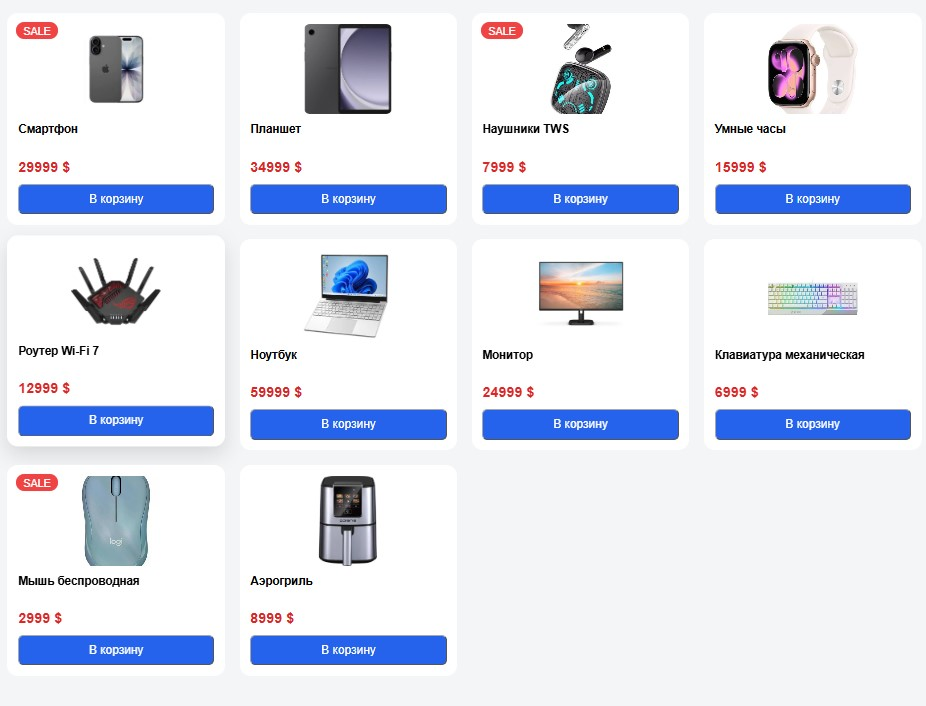  
Карточки товаров. У каждого товара есть картинка, название и цена. Если товар участвует в акции, на карточке отображается красный бейдж «SALE». Кнопка «В корзину» отправляет POST-запрос на сервер и добавляет товар в текущую сессию пользователя.  
  
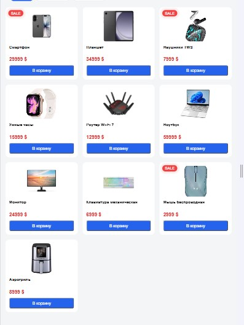  
Расширение сетки меняется под размер гаджета (под десктпоный, планшетный и смартфонный варианты)  

## Демонстрация работы API  
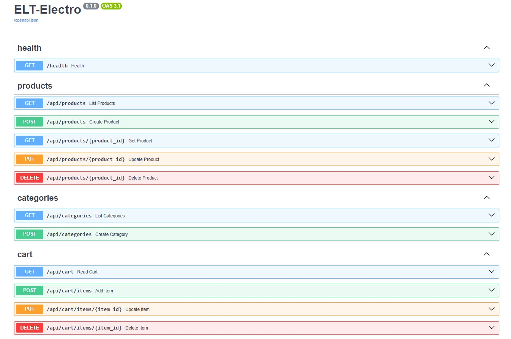  

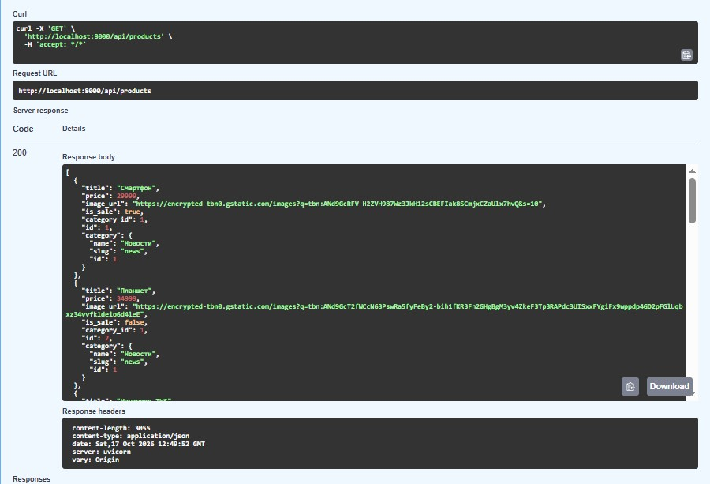  


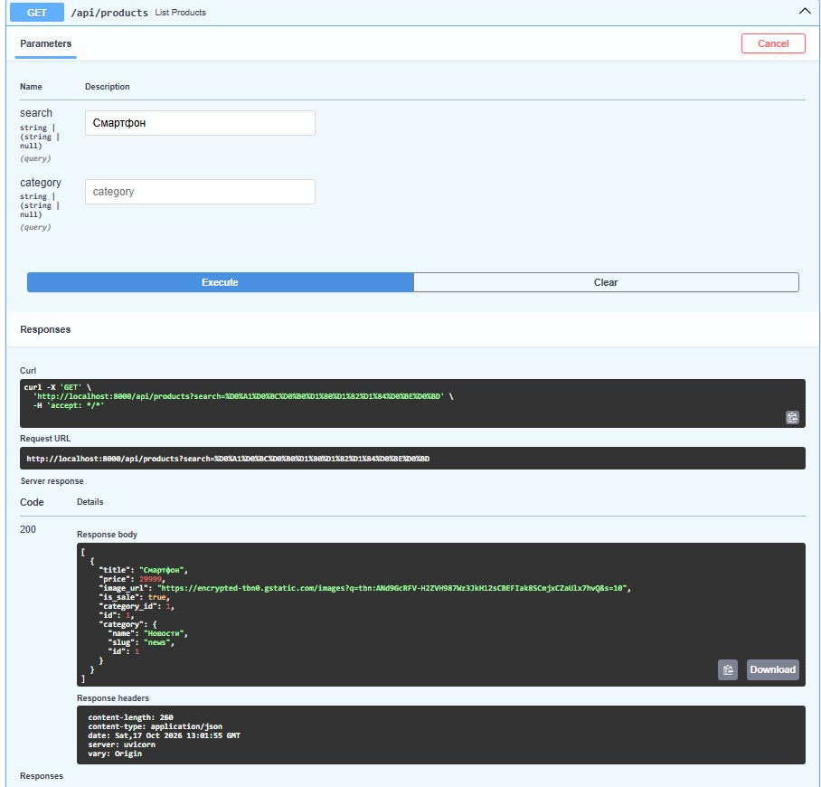  
 

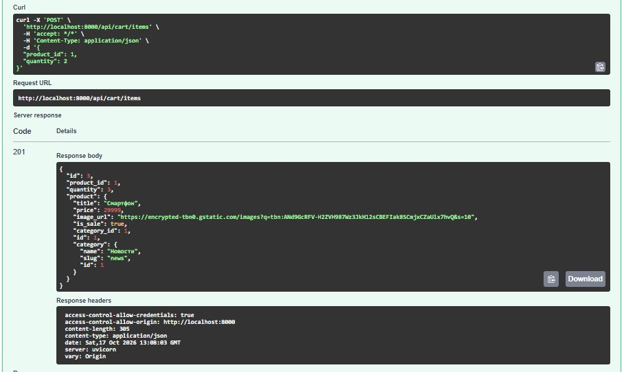  
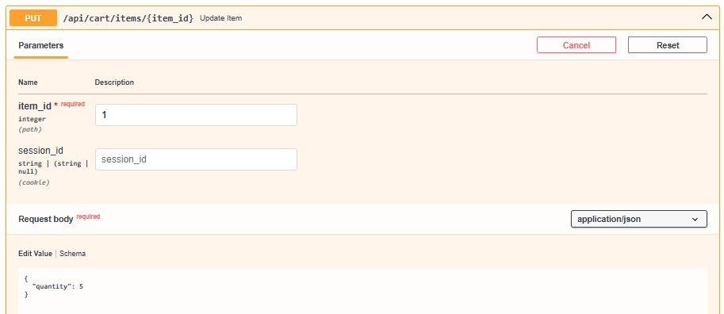  
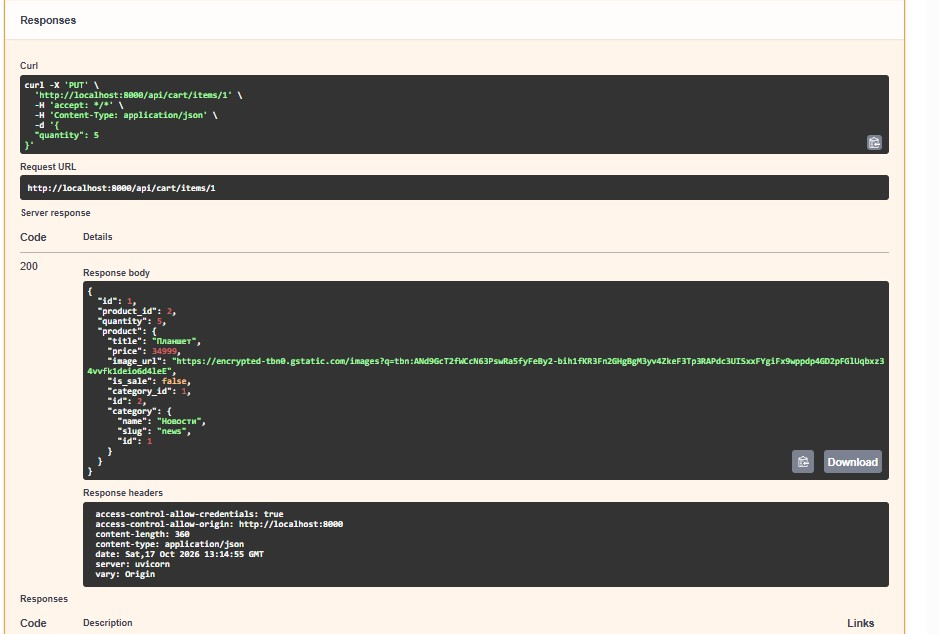  

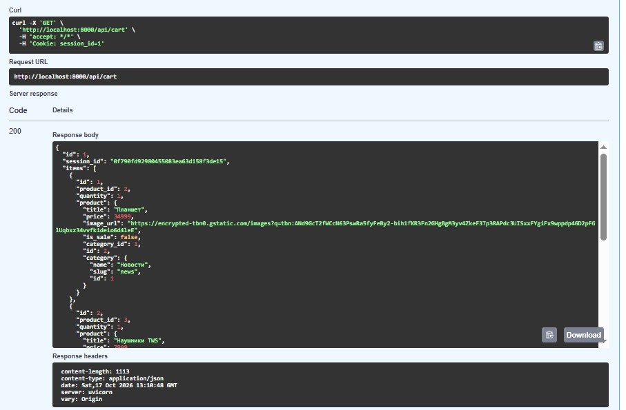  

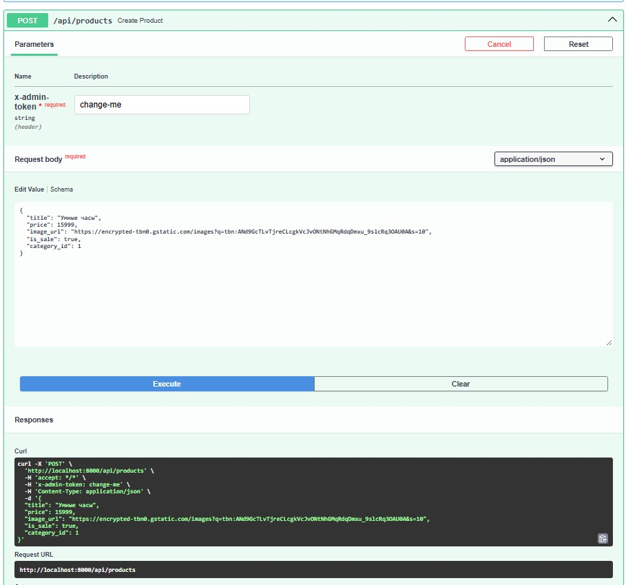  

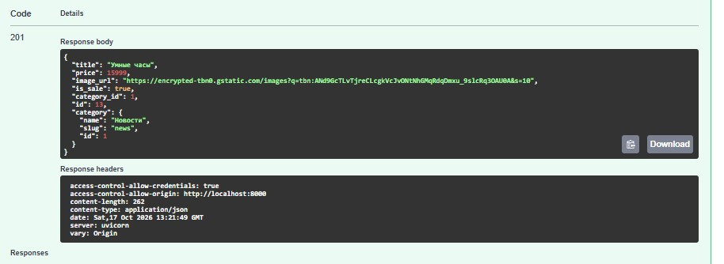  

## Как запустить проект  
Для запуска понадобятся установленные **Docker** и **Docker Compose**.  
1. Клонируйте репозиторий:
   ```bash
   git clone https://github.com/Adieva15/elt-electro.git
   cd elt-electro

2. Создайте файл .env в корне проекта (можно скопировать из .env.example):
    ```bash
    cp .env.example .env  

3. Запустите проект (Docker сам соберет образ, поднимет БД, применит миграции и загрузит тестовые товары):
    ```bash
    docker compose up --build  
Откройте в браузере:  
Сайт: http://localhost:8000  
Swagger-документация (API): http://localhost:8000/docs  

### мини-шпаргалка
Health  
GET  /health              — проверка, что сервер жив (для Docker healthcheck)  

Товары  
GET  /api/products                    — список товаров  
GET  /api/products?category=news      — фильтр по категории (slug)  
GET  /api/products?search=смартфон    — поиск по названию  
GET  /api/products/{id}               — один товар по id  
POST /api/products                    — создать товар (только админ)  
PUT  /api/products/{id}               — изменить товар (только админ)  
DELETE /api/products/{id}             — удалить товар (только админ)  

Категории
GET  /api/categories      — список категорий (для табов)  

Корзина  
GET    /api/cart              — содержимое корзины (по session_id из cookie)  
POST   /api/cart/items        — добавить товар {product_id, quantity}  
PUT    /api/cart/items/{id}   — изменить количество  
DELETE /api/cart/items/{id}   — удалить позицию  

### работа с докером
docker ps    
source .venv/bin/activate      # Linux/Mac  
.venv\Scripts\activate       # Windows  


docker compose up -d db  

docker compose ps  

Если БД уже была создана ранее и данные не удалялись — миграции уже применены, но команда безопасна:  
alembic upgrade head  

Залить данные (если БД пустая)  
python -m scripts.seed  

uvicorn app.main:app --reload  

Остановить, когда закончил
В терминале с uvicorn: Ctrl+C.
Postgres оставь работать или останови:  
docker compose stop db       # остановить, данные сохранятся   
docker compose down          # остановить и удалить контейнеры,   volume с данными останется  
<!-- docker compose down -v       # ОПАСНО: удалит и volume с данными -->

Пересоздать данные seed.py:  
docker compose exec db psql -U app -d app -c "TRUNCATE cart_items, products, categories RESTART IDENTITY CASCADE;"  
python -m scripts.seed  

Проверка:  
docker compose ps          два сервиса: db и app  
docker compose logs app    посмотреть, что миграции применились  